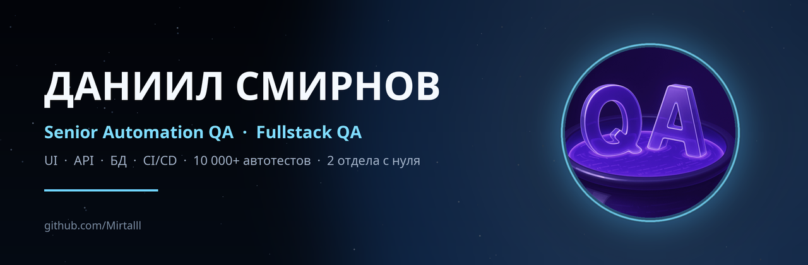

  
    

  
   

  
  
  
   
  

---

## 👋 Обо мне

Senior Automation QA / Fullstack QA с опытом **5 лет 9 месяцев**. Строю автоматизацию с нуля: архитектура фреймворка, команда, CI/CD и AI-инструменты.

Держу в поддержке **10 000+ автотестов**: UI, API, mocks и backend на трёх крупных проектах. Построил **два отдела автоматизации** — 4 и 3 человека. Внедрил AI/LLM в генерацию Page Objects и локаторов — скорость написания тестов выросла с **10 до 30–40 в неделю** на человека.

---

## 🚀 Результаты

| Метрика | Значение |
|:--|:--|
| Опыт в автоматизации | **5 лет 9 месяцев** |
| Отделы автоматизации с нуля | **2** — 4 и 3 человека |
| Автотесты в поддержке | **10 000+** |
| Крупных проекта | **3** |
| Скорость написания тестов с AI | **10 → 30–40 в неделю** |

---

## 🛠 Стек

  
    

  
  
  
  
  
  
  
  
  
  

---

## 🧪 Чем закрываю задачи

| Направление | Инструменты и опыт |
|:--|:--|
| **UI-автоматизация** | Playwright, Cypress, Selenium, TypeScript / JavaScript, Page Factory |
| **API и backend** | pytest, requests, REST, JSON Schema, моки, перехват HTTP |
| **Базы данных** | PostgreSQL, SQL-запросы, проверка интеграций и генерация тестовых данных |
| **CI/CD** | GitLab CI, GitHub Actions, Jenkins, Docker, Allure Server, Telegram-отчёты |
| **AI в QA** | Cursor, LLM: генерация локаторов и Page Objects, анализ кода |
| **Команда** | найм, онбординг, менторство, code review |

---

## 🧠 Как я работаю

1. **Архитектура.** Проектирую фреймворк: Playwright и Cypress, Page Factory, единый NPM-пакет UI + API для всех проектов компании.
2. **Автоматизация.** Закрываю UI, API и backend: pytest, requests, моки — 10 000+ автотестов на трёх крупных проектах.
3. **Процесс.** Встраиваю тесты в CI/CD: пайплайны, Quality Gates, Allure Server и Telegram-отчёты.
4. **Команда + AI.** Cursor и LLM для Page Objects и локаторов; найм, менторство и code review — два отдела с нуля, 4 и 3 человека.

---

## 💼 Опыт

| Компания | Роль и период |
|:--|:--|
| **CRT** | Senior Automation QA · мар 2024 — сен 2026 Система мониторинга недропользования, «Управление производством» (Сибгео) |
| **МЕДИАСЕТЬ** | Fullstack QA · янв 2021 — авг 2022 «Медиасеть.Маркет» — экосистема управления продажами на маркетплейсах |

---

## 📦 Открытый код

- **[pw-start-automation](https://github.com/Mirtalll/pw-start-automation)** — Playwright + TypeScript: архитектура Page → Fragment → Component, 19 Allure-матчеров, API-моки, 7 ESLint-правил, CI на GitHub Actions.
- **[Презентация](https://aqasmirmain.github.io/qa-presentation/presentation.html)** — мини-дек: опыт, стек, подход и контакты.

---

## 🔭 Сейчас

- Открыт к роли **Senior Automation QA / SDET**
- Москва · удалённо · готов к командировкам
- Развиваю AI-assisted тестирование и публичное портфолио QA-фреймворков

---

  <i>Хороший тест — понятный тест. Стабильная автоматизация важнее зелёного прогона.</i>
    

  
  

<!-- refreshed: 2026-11-08T23:20:00Z -->
