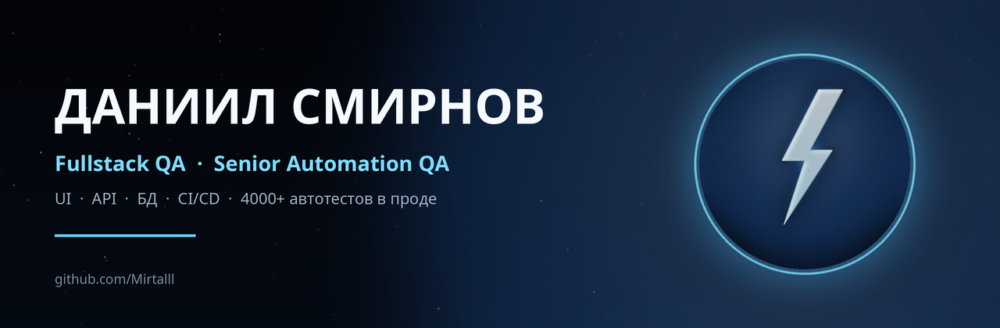

  
    

  
   

  
  
  

---

## 👋 Обо мне

Fullstack QA с **5+ годами опыта**. Строю автоматизацию с нуля и веду UI, API и БД в одном фреймворке.

Довёл собственный фреймворк на **Playwright + Python** до продакшена: **4000+ автотестов** со стабильностью прогона **90%**. Внедряю AI/LLM в генерацию локаторов и анализ кода — скорость написания тестов выросла в **3–4 раза**.

---

## 🚀 Результаты

| Метрика | Значение |
|:--|:--|
| Автотесты в продакшене | **4000+** |
| Стабильность прогона | **90%** |
| Сокращение времени регресса | **−40%** |
| Покрытие тестами | **до 70%** |
| Скорость написания тестов | **×3–4** |
| Менторство | **2–3 QA** |

---

## 🛠 Стек

  
    

  
  
  
  
  
  

---

## 🧪 Чем закрываю задачи

| Направление | Инструменты и опыт |
|:--|:--|
| **UI-автоматизация** | Playwright, Selenium, JavaScript, Page Object, стабильные локаторы |
| **API-тестирование** | Python Requests, Postman, REST, JSON Schema, моки, перехват HTTP |
| **Базы данных** | PostgreSQL, SQL-запросы, проверка интеграций и генерация тестовых данных |
| **CI/CD** | GitLab CI, Jenkins, Docker, Allure Server, автоматические прогоны |
| **AI в QA** | Cursor, LLM: генерация локаторов, анализ кода и тестов |
| **Процессы** | Тест-планы, чек-листы, баг-репорты, код-ревью, менторство |

---

## 📊 GitHub статистика

  
  

  

  

---

## 📈 Активность

  

  <picture>
    <source media="(prefers-color-scheme: dark)" srcset="https://raw.githubusercontent.com/Mirtalll/Mirtalll/output/github-snake-dark.svg" />
    <source media="(prefers-color-scheme: light)" srcset="https://raw.githubusercontent.com/Mirtalll/Mirtalll/output/github-snake.svg" />
    
  </picture>

---

## 💡 Мой подход

- Сначала риски и требования — потом тесты
- Автоматизация должна быть поддерживаемой, а не просто зелёной
- AI ускоряет рутину, но не заменяет мышление тестировщика

---

## 🔭 Сейчас

- Развиваю подходы к AI-assisted тестированию
- Собираю публичное портфолио QA-фреймворков
- Открыт к предложениям: **Fullstack QA / Senior Automation QA**, удалённо

---

  <i>Хороший тест — понятный тест. Стабильная автоматизация важнее зелёного прогона.</i>
    

  
  
    

  

